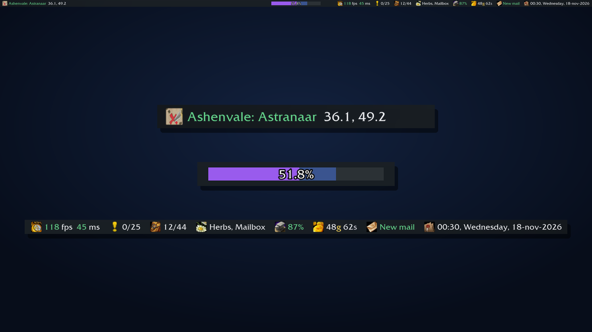

# EverlookDB Bar

Info bars and a clean minimap for WoW Forever (1.60.1, interface 16001).

*(screenshot to come)*

## What it does

**Bars.** As many as you like: along the top, bottom, left or right edge, or anywhere. One row or two (or more),
the whole edge or a set length, any background colour and opacity (black at 60% by default), font, size and
spacing. Side bars stack their plugins. Plugins sit in left, centre and right groups.

**Plugins.** Every LibDataBroker plugin from any addon can go on a bar. Built in (each one switchable, each one a normal LDB plugin):

- **XP bar**: a thin bar with rested XP and the percentage. Hidden at max level.
- **Reputation bar**: one faction as a thin bar like the XP bar, coloured by standing (red, orange, yellow, green).
  Follows your watched faction, or pick one in the settings or with a right-click. Stays at max level.
- **Professions**: your skill in each profession (Mining 187, Herb 150, Cook 225); click one to open it, right-click
  for the list. A skill at its cap is coloured: time for the next rank at a trainer.
- **Performance**: FPS and latency; memory, CPU per addon and bandwidth in the tooltip.
- **Location**: zone, subzone (Tarren Mill, Southshore Inn) and coordinates. Click to open the map.
- **Tracking**: what the minimap tracks (Herbs, Mailbox). Click for a menu of everything you can track, with tick
  boxes: find spells (Find Herbs, Find Minerals, Track Beasts...) and townsfolk (Mailbox, trainers, Flight Master,
  Innkeeper, Banker, Auctioneer, Repair, Stable Master...). Right-click: untrack all. In combat the menu only shows.
  It does what the minimap's tracking button does, so that button can stay hidden. Settings: every tracked type, the
  first only, or just the icon.
- **Durability**: your most worn item in percent; every slot in the tooltip.
- **Mail**: new mail or not, with the senders.
- **Bags**: free and total slots; profession bags apart.
- **Quest log**: quests in your log out of the most you can have (38/45); yellow when nearly full, red when full.
- **Gold**: with this session's change in the tooltip.
- **Calendar**: the date or today's next event, pending invites, the coming week in the tooltip; answer invites with
  a right-click.
- **Clock**: off by default.

**Clean minimap.** Square (the default) or round, a border of your thickness and colour, any size, anywhere on
screen, and an optional zone line showing where you stand.

**The pieces around the minimap.** The zone name, tracking button, mail icon, calendar button, day and night dial,
clock, coordinates, zoom buttons and addon menu button each have one switch on the Minimap page: on or off, at once.
A piece that is on sits on the minimap's edge, above the map, and moves and grows with it. Each has its own place to
start with; to change it, press **Unlock to move** and drag it. It slides along the edge (the ring of a round
minimap, the outline of a square one) and snaps to the corners and the middle of the sides; hold Shift to put it
anywhere. Change the shape later and the pieces follow the new edge. "Reset" on a row, or a right-click on the piece
while moving, puts one back.

**Addon buttons.** Every addon's minimap button goes into one small drawer beside the minimap, with its own icon,
tooltip and click, or is hidden.

If another addon already manages the minimap, EverlookDB Bar leaves the minimap alone, says
so once in chat and at the top of the Minimap page, and greys out what doesn't apply.

## Using it

- `/ebar` opens the settings window. Everything in it also works from chat (see Commands below).
- On the Plugins page of `/ebar`, drag a plugin's row to reorder it, move it to another group or bar, or drop it in
  "Not on a bar" to take it off; drag from there onto a bar to add it. Right-click or Escape cancels a drag.
- **Unlock to move** (the button on the Minimap page and at the bottom left of the window, or `/ebar unlock`): drag
  bars to any edge or anywhere, the minimap where you like, the pieces around it, and plugins
  between bars and groups. A grid helps you line things up. Escape locks again.
- While moving, a small control in the middle of the minimap has **Done** and **Reset positions** (the minimap back in
  the top-right corner at 100%, every piece back in its own place); the mouse wheel over the minimap changes its
  size. Dots show the edge the pieces stick to. Escape ends it too, and so does combat.
- `/ebar minimap.mail on` (or `off`) switches a piece from chat; `/ebar minimap reset` puts the minimap and its pieces
  back.
  `/ebar minimap scan` lists any other text shown around the minimap and the addon it comes from.
- `/ebar perf` shows what EverlookDB Bar itself costs.

## Commands

`/ebar` (also `/everlookbar`) follows the same pattern as every EverlookDB addon:

- `/ebar` opens the settings window; it's also under Settings > AddOns.
- `/ebar bar.edge left` (or `/ebar set bar.edge left`): change a setting; `/ebar bar2.edge left` changes bar 2. `/ebar get` lists every setting, `/ebar get bar.edge` shows one.
- `/ebar unlock`, `/ebar lock` (or `move`, which flips it): drag bars, plugins, the minimap and the pieces around it.
- `/ebar bar`, `bar 2`, `bar add left`, `bar delete 2`; `/ebar plugins`, `place gold 1 right`, `remove gold`.
- `/ebar minimap unlock`, `lock` (the same as `/ebar unlock` and `lock`), `reset`, `scan`, `grab <frame>`, `ignore <frame>`.
- `/ebar minimap.<piece> on|off`: zone, tracking, mail, calendar, daynight, clock, coords, zoom, compartment, ringart.
- `/ebar reset bars`, `/ebar reset all`, `/ebar minimap reset` ask first (type it again within 10 seconds); `/ebar reset all confirm` still works.
- `/ebar search <words>` opens the window with its search box filled; `/ebar status` (bars, plugins, memory), `/ebar version`, `/ebar perf`.
- `/ebar help` (or `?`) lists every command; a mistyped one suggests the nearest.

## Built to stay out of the way

- Light: plugins update only when something changes, so the bar costs next to nothing.
- A broken plugin from another addon gets a small red marker; the bar keeps going.
- Safe in combat: nothing the game protects is touched while you fight. Minimap changes wait until combat ends.
- Works alongside NoAutoClose and BlizzMove.

## For plugin authors

Any LibDataBroker plugin works as is. To add your own widgets and settings, see [API.md](API.md) or the guide at
https://everlookdb.com/ebar/plugins (also on the "Build your own" page of `/ebar`).

## Credits and license

EverlookDB Bar is licensed under GPL-3.0 (see `LICENSE`). Bundled: LibStub (public domain), CallbackHandler-1.0
(Ace3 Development Team, BSD-style licence in `Libs/CallbackHandler-1.0/LICENSE.txt`).
